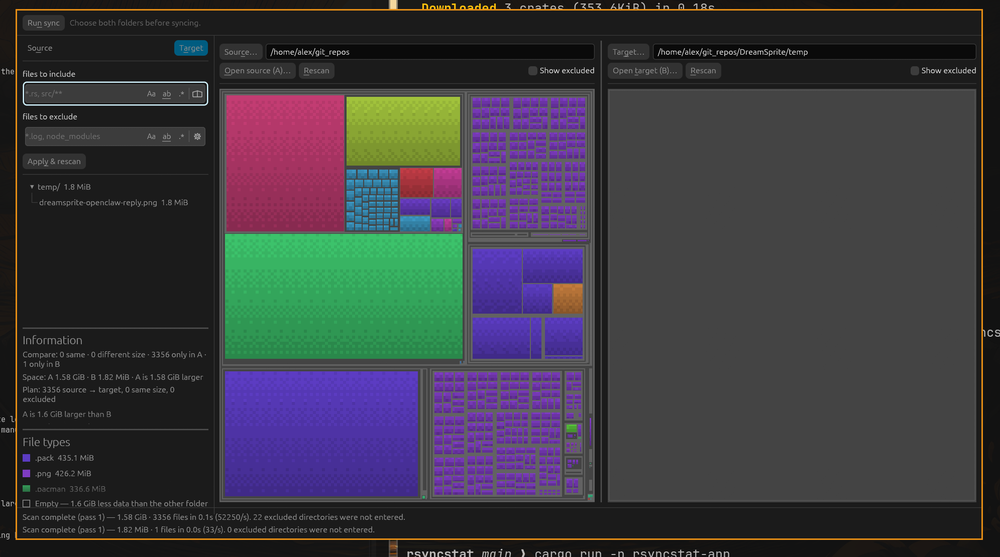

<div align="center">

# RSyncStat

**See your folders. See your sync. One map.**

A native Rust desktop app that fuses a WinDirStat-style disk treemap with two-way folder sync, so the space map *is* the sync preview.

[](https://github.com/okita-io/rsyncstat/actions/workflows/ci.yml)
[](LICENSE)
[](rust-toolchain.toml)
[](#platform-notes)
[](https://github.com/emilk/egui)
[](https://github.com/okita-io/rsyncstat/commits/main)
[](https://github.com/okita-io/rsyncstat/issues)
[](CONTRIBUTING.md)

</div>

> **Status:** early development. Scanning, the treemap and the folder tree work today. One-way copy from folder A to B (never overwriting) works; true two-way sync with a stored snapshot is still to come. See [Roadmap](#roadmap).

<p align="center">
  
</p>

## Why

Disk visualizers show where the space goes but never move a byte. Two-way sync tools move bytes but show the result as a list. RSyncStat puts both on one screen so you can see what a sync will do, and how big it is, before you run it. The full design lives in [docs/SPEC.md](docs/SPEC.md).

## Features

**Disk map**
- Squarified treemap with hit testing, linked to a directory tree and a file-type legend
- Live results: the tree and treemap fill in while the scan is still running
- Parallel scanner (up to two workers per CPU core) that never descends into excluded directories
- Deterministic, readable per-extension colors
- Dithered tiles on one shared pixel grid, with consistent match outlines and hover highlight
- Elided path display for long paths

**Exclude filters (first class)**
- Gitignore-style rules via the `ignore` crate
- Built-in presets: `*.lancedb`, `node_modules/`, `target/`, `.venv/`, system junk files
- Excluded entries stay visible, drawn with a hatch pattern, so you can see what is skipped

**Two panes, compare and sync**
- Source and target panes side by side, each with its own folder picker, rescan and "show excluded" toggle
- Compare summary: files that are the same, different in size, or only on one side, plus total space and the size gap
- One-way copy from source to target with a plan preview, progress, and stop
- Never overwrites: an existing file is hashed, skipped if identical, and listed (not replaced) if different
- Safe writes: temp file then rename, retries on transient errors, refuses unsafe paths and symlinked target folders
- Free-space tiles show how much room is left on each volume
- Reveal in file manager, and move to Trash after confirmation

**Include and exclude patterns**
- Separate "files to include" and "files to exclude" fields with match-case, whole-word and regex toggles
- Built-in preset list you can switch on or off; "Apply & rescan" re-walks both folders

**Keyboard first**
- Tab follows the visual layout, with high-contrast focus rings
- Windows/GTK-style Alt mnemonics (egui has no built-in access keys)
- Ctrl-based global shortcuts that avoid Hyprland's Super bindings; F1 opens the cheat sheet
- File menu, Escape to cancel scans

**Cross-platform**
- macOS, Windows, and Linux including Arch/Omarchy on Hyprland (Wayland)
- GPU rendering through eframe + wgpu

## Install

There are no prebuilt releases yet. Build from source.

### Prerequisites

- Rust **stable 1.95 or newer** (required by eframe/egui 0.37; see `rust-toolchain.toml`)
- Platform libraries for the GUI (see [Platform notes](#platform-notes))

### Build and run

```bash
git clone https://github.com/okita-io/rsyncstat
cd rsyncstat
cargo run --release -p rsyncstat-app
```

The release binary is `target/release/rsyncstat` (`rsyncstat.exe` on Windows). Use **Open folder…** to pick a root.

## Workspace layout

| Crate | Role |
|-------|------|
| `rsyncstat-model` | Scan tree types, file colors, byte and path formatting |
| `rsyncstat-filter` | Built-in exclude presets and gitignore-style rules |
| `rsyncstat-scan` | Parallel walk, prunes excluded directories |
| `rsyncstat-treemap` | Squarified layout and hit testing |
| `rsyncstat-plan` | Compare two trees and decide which files to copy (pure logic) |
| `rsyncstat-exec` | Run a plan: atomic copy, hash check, retries, cancel |
| `rsyncstat-app` | eframe/egui + wgpu desktop UI |

Inside `rsyncstat-app`, `src/app/` holds window state and behavior split by concern (`scan_ctl`, `sync_ctl`, `input`, `frame`, `pane`, `pane_view`), and `src/ui/` holds the widgets (`treemap`, `tree_view`, `legend`, `dither`, `diff`, `patterns`). The index, reconcile and transport crates will be added when their milestones start.

## Roadmap

- [x] Scanner, treemap, tree, legend, exclude presets
- [x] Keyboard navigation and mnemonics
- [ ] Snapshot index and three-way reconcile (Unison-style)
- [ ] Visual sync plan you approve before anything is written
- [ ] Safe execution: trash, atomic writes, resumable runs
- [ ] Remote host over SSH via the agent

Milestones are detailed in [docs/SPEC.md](docs/SPEC.md#mvp-milestones).

## Development

```bash
cargo fmt --all -- --check
cargo test --workspace
cargo build --workspace --locked
```

CI runs on Ubuntu, macOS and Windows. See [CONTRIBUTING.md](CONTRIBUTING.md) before opening a PR.

## Platform notes

### macOS

- Install the Xcode command line tools if Rust was not installed via `rustup`.
- First run may prompt for folder access depending on what you scan.

### Windows

- Install Visual Studio Build Tools (MSVC linker) if `rustup` did not configure it.
- The wgpu 30 stack needs a single `windows` crate version (0.62.x) for both `wgpu-hal` and `gpu-allocator`. If `cargo update` reintroduces `windows` 0.58, run `cargo update -p windows@0.58.0 --precise 0.62.2` and commit `Cargo.lock`.
- Run: `target\release\rsyncstat.exe`

### Linux (including Arch / Omarchy / Hyprland)

Arch:

```bash
sudo pacman -S --needed base-devel pkgconf gtk3 libxkbcommon wayland
```

Debian/Ubuntu:

```bash
sudo apt install libgtk-3-dev libxcb-render0-dev libxcb-shape0-dev libxcb-xfixes0-dev libxkbcommon-dev libssl-dev
```

**Hyprland (Wayland):** there is an open egui report that keyboard input is ignored on Hyprland ([#8249](https://github.com/emilk/egui/issues/8249)); confirm focus and typing in text fields on a real session. A related Wayland repaint stall on hidden workspaces was addressed in egui 0.37 ([#5136](https://github.com/emilk/egui/issues/5136)).

## Contributing and security

Contributions are welcome: see [CONTRIBUTING.md](CONTRIBUTING.md) and the [Code of Conduct](CODE_OF_CONDUCT.md). Report vulnerabilities privately as described in [SECURITY.md](SECURITY.md). Changes are tracked in [CHANGELOG.md](CHANGELOG.md).

## Acknowledgements

RSyncStat stands on a lot of prior work.

**Inspiration**
- [WinDirStat](https://windirstat.net/), [QDirStat](https://github.com/shundhammer/qdirstat), [GrandPerspective](https://grandperspectiv.sourceforge.net/) and [WizTree](https://diskanalyzer.com/) for the disk-map interaction model
- [Unison](https://github.com/bcpierce00/unison) for the archive-based, three-way sync design
- [FreeFileSync](https://freefilesync.org/), [Syncthing](https://syncthing.net/), [rclone bisync](https://rclone.org/bisync/) and [Mutagen](https://mutagen.io/) for safety ideas

**Algorithms**
- Bruls, Huizing and van Wijk, [*Squarified Treemaps*](https://www.win.tue.nl/~vanwijk/stm.pdf) (2000)

**Libraries**
- [egui / eframe](https://github.com/emilk/egui) by Emil Ernerfeldt and contributors (MIT/Apache-2.0)
- [wgpu](https://github.com/gfx-rs/wgpu) (MIT/Apache-2.0)
- [egui_ltreeview](https://github.com/LennysLounge/egui_ltreeview)
- [ignore](https://github.com/BurntSushi/ripgrep/tree/master/crates/ignore) by Andrew Gallant (Unlicense/MIT)
- [rayon](https://github.com/rayon-rs/rayon), [crossbeam](https://github.com/crossbeam-rs/crossbeam), [serde](https://serde.rs/), [tokio](https://tokio.rs/)
- [BLAKE3](https://github.com/BLAKE3-team/BLAKE3), [redb](https://github.com/cberner/redb), [trash-rs](https://github.com/Byron/trash-rs), [rfd](https://github.com/PolyMeilex/rfd), [postcard](https://github.com/jamesmunns/postcard)

Exact versions and transitive dependencies are in [Cargo.lock](Cargo.lock). All trademarks belong to their owners; RSyncStat is not affiliated with any project listed here.

## License

[MIT](LICENSE) © 2026 okita.io
