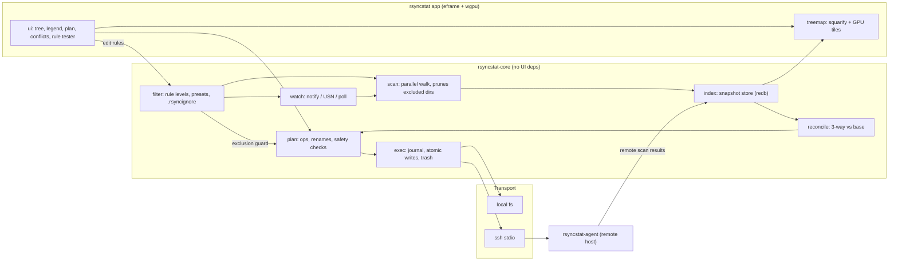

# RSyncStat: spec and architecture

A native Rust app that shows two folders as one disk-usage treemap colored by sync state, previews the sync plan, and runs a safe two-way sync, with exclude filters as a first-class MVP feature.

## Table of contents

- [The idea](#the-idea)
- [Goals and non-goals](#goals-and-non-goals)
- [What exists today](#what-exists-today)
- [Core UX](#core-ux)
- [Exclude filters](#exclude-filters)
- [Sync engine](#sync-engine)
- [Architecture](#architecture)
- [Performance targets](#performance-targets)
- [Platform notes](#platform-notes)
- [Recommended stack](#recommended-stack)
- [MVP milestones](#mvp-milestones)
- [Open questions](#open-questions)
- [Sources](#sources)

## The idea

Disk visualizers show where the space goes but never move a byte. Two-way sync tools move bytes but show the result as a list. RSyncStat puts both on one screen: the space map is the sync preview, so you can see what a sync will do, and how big it is, before you run it.

**Recommendation:** Build it in Rust on eframe/egui with the wgpu renderer, drawing the treemap with a custom GPU paint callback. Model the sync engine on Unison: a stored last-synced snapshot per profile, three-way reconciliation, and a plan you approve before anything is written.

## Goals and non-goals

### Goals

- One native app for macOS, Windows and Omarchy (Arch, Hyprland on Wayland)
- WinDirStat-style view: treemap, directory tree, file-type legend, all linked
- Two-way sync of two roots with a stored snapshot, so deletes and renames propagate
- Exclude filters from day one: gitignore rules, sensible defaults, and excludes that can never cause a delete
- Every sync starts as a visual plan; nothing is written until you approve it
- Safe by default: trash instead of delete, atomic writes, resumable runs
- Stays responsive on trees with millions of files
- Local folders first, then a remote host over SSH

### Non-goals for v1

- Backup or versioning system (no history beyond the trash)
- Cloud storage backends such as S3 or Google Drive (rclone covers these)
- Always-on peer-to-peer mesh like Syncthing
- rsync wire-protocol compatibility
- More than two roots per profile
- Mobile apps

## What exists today

### Disk visualizers

| Tool | Platforms | Strength | Gap for RSyncStat |
|------|-----------|----------|-------------------|
| WinDirStat 2.x | Windows | Classic treemap, tree and type list; MFT scan when elevated; snapshots, duplicates | No sync, Windows only |
| WizTree | Windows | Reads the NTFS MFT directly, very fast on local NTFS | No sync, closed source, Windows only |
| QDirStat | Linux | Treemap plus linked tree and cleanup actions (Qt) | No sync, no two-root view |
| GrandPerspective | macOS 14+ | Maintained native treemap | No sync, macOS only |
| Disk Inventory X | Older macOS | Treemap plus type legend | Outdated, no sync |
| dua-cli | All (TUI) | Rust, parallel scan, interactive delete | Terminal only, no treemap |
| gdu | All (TUI) | Go, fast parallel scan | Terminal only, no treemap |
| diskonaut | All (TUI) | Rust terminal treemap | Last upstream commit March 2024; fork exists |

### Two-way sync tools

| Tool | Model | Strength | Gap for RSyncStat |
|------|-----------|----------|-------------------|
| Unison | Archive of last-synced state, 3-way | Correct reconciliation, conflict review, atomic temp-then-rename | Dated UI, list view only |
| FreeFileSync | `sync.ffs_db` on each side | Good GUI, move detection via file IDs from the second sync | Grid view, no space map; SFTP has no move detection |
| Syncthing | Continuous P2P, block exchange | Always-on, only changed blocks travel | No up-front plan; conflicts become `.sync-conflict` files |
| rclone bisync | Listings of last run | Huge backend list, `--max-delete`, empty-side guard | CLI; first run needs `--resync` |
| Mutagen | 3-way vs last agreed state | Fast dev loops over SSH and Docker, safe and resolved modes | Developer focus, no visual review |

None of them shows a sync as a spatial, size-weighted picture, and none of the visualizers can act on two roots. That gap is the product.

## Core UX

### Side-by-side source and target (A / B)

The main workspace is built for comparing two roots before sync exists:

- **Source (A)** on the left and **Target (B)** on the right, each with its own folder picker and parallel scan
- Matching entries use the **same file-type color key** in both panes so grids line up conceptually by relative path
- Hover or select in one pane draws a **counterpart highlight** in the other pane when the same relative path exists (gold outline today; M1 adds true sync-diff overlays)
- A **draggable splitter** adjusts the relative widths; a toolbar toggle **collapses to a single pane** for one-root disk analysis
- Treemap tiles reserve visual semantics for later diff states: only in A, only in B, changed, conflict, excluded (hatched)

The directory tree and file-type legend follow the **active pane** (tabs for tree A / tree B). The status bar reports scan progress per pane (see below).

### Diff treemap

In the union view a tile's area is the larger of its two sides, so items that exist on only one side still show up. Excluded items stay on the map, hatched, so you can see what the filters are keeping out of the sync.

- Three panes, linked: directory tree with both sizes, the treemap, and a file-type legend; selecting in one highlights the others
- Color mode switch: sync state (default) or file type, the WinDirStat way
- Cushion shading on tiles, as in WinDirStat, so nesting reads without borders
- Sync state rolls up: a folder shows the share of its bytes in each state, so big changes jump out
- Single-root mode doubles as a plain disk analyzer with reveal, trash and open-in-terminal

### Scan progress status bar

While a pane is scanning, the bottom status bar shows the **current path** being visited (best-effort during parallel walks):

- Text is measured with **egui fonts** and uses as much width as the window allows
- If the full path does not fit, **elide from the middle**, keeping the volume/root prefix and the deepest folders plus file name (e.g. `C:\Users\alex\…\deep\folder\file.bin`)
- Layout **recomputes on resize**; the **full path** is always available in a hover tooltip
- One line per pane, prefixed `A:` and `B:` when side-by-side; single-pane mode shows only the active scan line

### Plan, then run

1. **Scan** — Both roots scan in parallel; excluded folders are skipped without being entered; the treemap fills in as results arrive.
2. **Reconcile** — Each in-scope path is compared with the stored snapshot to get a proposed action.
3. **Review the plan** — Totals per action (bytes and counts per direction, deletes, moves, conflicts, excluded) plus the colored map. Click any tile to override its action.
4. **Run** — Progress paints onto the map: tiles turn gray as they reach identical. Pause and cancel are safe at any point.
5. **Report** — A log of every op with a link to anything in the trash.

### Conflict resolution

- A conflicts list beside the map, sorted by size, with both sides' size, mtime and hash
- Per item: keep left, keep right, keep both (rename the loser with a suffix), or skip
- Quick look for text and images; an external diff tool can be set per extension
- Bulk rules on a selection, such as newer wins for this folder
- Unresolved conflicts never block the rest of the plan

### Profiles

- A profile is two roots plus filters, conflict policy, metadata options and safety limits, saved as a TOML file
- Each profile keeps its own snapshot, so the same folder can be paired with several others

## Exclude filters

Filters are an MVP feature, not a setting buried in preferences. A path that matches an exclude rule is out of scope: it is never copied, overwritten, moved or deleted on either side, and it costs nothing to scan when it is a folder.

> **Excluded is not deleted:** Adding an exclude must never propagate a delete. When a path becomes excluded, its snapshot entry is parked, not removed, and the planner refuses any op whose path is excluded on either side. A folder being trashed on one side keeps any excluded content inside it, so the folder itself stays.

### Rule levels

| Level | Where it lives | Synced? | Precedence |
|-------|----------------|---------|------------|
| Built-in presets | In the app; groups switch on/off per profile | No | Lowest |
| Global | A per-machine ignore file in the app's config folder | No | Above presets |
| Profile | `rules` list in the profile TOML | No; lives with the profile | Above global |
| Folder | `.rsyncignore` in any folder of either root | Yes, like any file | Highest; deeper folders win |

- Gitignore syntax everywhere: `*`, `**`, `?`, leading `/` anchors to the folder, trailing `/` matches folders only, `!` re-includes
- Within and across levels the last matching rule wins, so a `.rsyncignore` can re-include what a preset excludes
- As in git, `!` cannot rescue a file whose parent folder is excluded, because that folder is never entered
- Global, profile and preset rules are compiled by the app and sent to the remote agent, so both sides use identical rules
- `.rsyncignore` is synced so both sides converge on the same rules; a path excluded on either side counts as excluded on both
- So rules only tighten mid-run: a removed rule takes effect after the edited `.rsyncignore` has synced, on the next run
- `.rsyncignore` files themselves can never be excluded, and `.gitignore` is not applied unless the profile opts in

### Default exclude set

```gitignore
# Built-in presets (each group can be switched off per profile)

# system junk
.DS_Store
._*
.Spotlight-V100/
.Trashes/
.fseventsd/
.TemporaryItems/
Thumbs.db
desktop.ini
$RECYCLE.BIN/
System Volume Information/

# temp and live database side files
*.tmp
*.swp
~$*
*.sqlite-wal
*.sqlite-shm
*.sqlite-journal
*.db-wal
*.db-shm
*.db-journal

# rebuildable data and build output
*.lancedb
node_modules/
target/
__pycache__/
.venv/

# RSyncStat's own state (always on)
.rsyncstat/

# opt-in, off by default
# .git/
```

Excluding a live database's `-wal` or `-shm` file while syncing the main file can still copy an inconsistent database. When a `.sqlite` or `.db` file has a `-wal` file beside it, the plan flags the main file as in use.

### Profile example

```toml
[profile]
name  = "mac-to-spark"
left  = "/Users/alexokita/git_repos"
right = "ssh://spark-4f07/home/okita/git_repos"

[filters]
presets = ["system-junk", "temp-and-live-db", "rebuildable"]
respect_gitignore = false     # opt-in: also apply .gitignore files

# gitignore syntax, top to bottom, last match wins
rules = [
  "*.log",
  "!deploy.log",              # re-include one file
  "datasets/raw/",            # whole tree, pruned during scan
]

# optional, files only, off by default
max_file_size = "4 GiB"
# skip_older_than = "2 years"
```

Size and age filters are optional and apply to files only, never to folders. A file over the limit on one side is excluded on both, so a file that grows past the limit is left alone rather than deleted.

### Filter UX

- Excluded items are hatched gray on the map and in the tree, with the total excluded size per side in the status bar
- Excluded folders are pruned unmeasured; their size shows as not measured until you run a low-priority Measure excluded pass, or comes free from the MFT read on NTFS
- Right-click a tile: Exclude this item, Exclude `*.ext`, or Exclude folders named this; then pick the level (profile or the nearest `.rsyncignore`)
- Every rule edit previews on the map first: items newly excluded, bytes removed from the plan, and confirmation that nothing on disk changes
- Hover or select any excluded tile to see the rule, level and line that excluded it

## Sync engine

Three phases, as in Unison: detect changes on each side against the base snapshot, reconcile the two change sets, then propagate. The snapshot is updated per path only once both sides agree. Excluded paths are removed before reconciliation and never reach the planner.

### Reconciliation rules

| Left vs base | Right vs base | Action |
|--------------|---------------|--------|
| Excluded | Anything | No op on either side; snapshot entry parked |
| Anything | Excluded | No op on either side; snapshot entry parked |
| Unchanged | Unchanged | None |
| New or changed | Unchanged | Copy left to right |
| Unchanged | New or changed | Copy right to left |
| Deleted | Unchanged | Move right copy to trash |
| Deleted | Changed | Conflict; default keeps the edit |
| Changed | Changed, same hash | Mark synced (false conflict) |
| Changed | Changed, different | Conflict |
| Deleted | Deleted | Drop from snapshot |
| No base yet | No base yet | Copy one-sided items; equal hashes are identical; anything else is a conflict |
| Rule removed | Rule removed | Back in scope; reconciled against the parked entry, so diverged copies become a conflict, never an overwrite |

Absence caused by a filter is never read as a delete, and the first run never picks a winner by mtime alone, which is the trap rclone's `--resync` warns about.

### Change detection

- Fast path: size, mtime, and file ID or inode compared with the snapshot; equal means unchanged
- Slow path: if size or mtime differs, hash the content with BLAKE3; a touched but identical file is not a change
- mtime tolerance per filesystem (FAT stores 2-second times) and an optional paranoid mode that hashes everything
- Watchers (notify, and the USN journal on NTFS later) only mark dirty subtrees for rescan; events under excluded paths are dropped

### Renames and moves

- On one side, pair a deleted path with a new path by file ID on the same volume, or else by size plus BLAKE3 hash
- If the other side's old path is unchanged, replay the move there instead of copy plus delete
- A move into an excluded folder is treated as leaving scope (no delete on the other side); a move out of one is a new file
- Ambiguous matches (several identical files) fall back to copy plus delete
- Case-only renames are their own op so case-insensitive volumes handle them

### Writes and deletion safety

- Write to a temp file in the target folder, fsync, check the hash, then rename over the target
- Just before replacing, re-stat the target; if it changed since the scan, the op becomes a conflict
- Deletes go to the OS trash locally and to `.rsyncstat/trash/<run>` on remotes
- Folder deletes trash only in-scope children; a folder holding excluded items is kept
- Root marker file in each root; a missing marker (unmounted drive) aborts the run
- Refuse to run if one side is suddenly empty, and stop at a max-delete limit per profile, like rclone
- The planner asserts that no op touches an excluded path, and a property test checks that adding any exclude rule never adds a delete

### Resumability

- The plan is written to a journal in the snapshot DB; each op is marked pending, done or failed
- Large copies go in chunks; a restart resumes from the last verified chunk of the temp file
- After a crash: rescan, replan against the journal, clean up stale temp files

## Architecture



| Crate | Job | Key deps |
|-------|-----|----------|
| `rsyncstat-model` | Node arena, paths, metadata, sync states, excluded flag | serde |
| `rsyncstat-filter` | Presets, global, profile and `.rsyncignore` levels; verdict with level, file and line; shared by scan, watch, plan and the rule tester | ignore (`gitignore` module) |
| `rsyncstat-scan` | Parallel walk; prunes excluded folders in `filter_entry` and records them; platform fast paths | ignore, rayon |
| `rsyncstat-index` | Snapshot store with parked entries, and the op journal | redb, blake3 |
| `rsyncstat-reconcile` | Three-way compare, rename pairing | none |
| `rsyncstat-plan` | Ops list, exclusion guard, safety checks, totals | none |
| `rsyncstat-exec` | Atomic writes, trash, resume | trash, tokio |
| `rsyncstat-transport` | Local fs and remote protocol over stdio | tokio, postcard |
| `rsyncstat-agent` | Headless binary run on the remote host | scan, filter, index, exec |
| `rsyncstat-treemap` | Squarified layout, level of detail, hit testing | none |
| `rsyncstat-app` | eframe app, wgpu paint callback | eframe, egui-wgpu |

The core has no UI dependency, so a CLI and the remote agent reuse it, and the reconcile and plan crates stay pure functions that are easy to test exhaustively.

### Filter implementation notes

- Rules compile with `ignore::gitignore::GitignoreBuilder`, which keeps git's meaning of `!` (re-include)
- Avoid `OverrideBuilder` for user rules: its `!` is inverted (a bare glob whitelists, `!` ignores)
- The walker runs with `standard_filters(false)` so `.gitignore` files and hidden files never drop paths silently
- A `filter_entry` predicate checks each entry, records excluded ones for the map, and returns false so excluded folders are not descended into
- Per-folder `.rsyncignore` matchers load once per folder and are cached; the watcher reloads one when it changes

## Performance targets

| Area | Target | How |
|------|--------|-----|
| Tree size | Millions of entries per side | Arena of fixed-size nodes with `u32` ids; interned names |
| Scan | Bound by the disk, not one thread | Parallel walk on all cores; MFT read on NTFS later |
| Excluded trees | Cost one directory entry each | Pruned before descending; measured only on request |
| Rule matching | Not a visible share of scan time | Compiled glob sets per level; per-folder matchers cached |
| Rescan | Work scales with changes, not tree size | Watcher or USN dirty marks, then a stat-only pass |
| Hashing | Only files whose size or mtime moved | BLAKE3, multithreaded for big files |
| Treemap | Smooth pan and zoom at display refresh | Layout on a worker thread; instanced quads on GPU; sub-pixel tiles merged |
| UI during scan | Never blocks | Progressive results over a channel |

These are design targets, not measurements. M0 sets real numbers on Alex's own drives before anything is promised.

## Platform notes

| Platform | Watch out for | Handling |
|----------|---------------|----------|
| macOS | APFS is case-insensitive by default; Unicode names may differ in normalization across systems | Compare names with a per-volume case and normalization policy; flag case-only collisions as conflicts |
| macOS | Full Disk Access needed for some folders; extended attributes and resource forks | Prompt once; sync xattrs only when the profile says so |
| macOS | Local copies on APFS | Use clone-on-write copies when both roots share a volume |
| Windows | Long paths over 260 characters | Use `\\?\` verbatim paths internally; Rust std adds the prefix when needed |
| Windows | NTFS alternate data streams, reserved names (`CON`, `NUL`), trailing dots and spaces | Skip ADS by default; refuse to create names Windows cannot open and report them |
| Windows | Fast scans | Optional elevated MFT read like WizTree, with the normal walk as fallback |
| Linux | Permissions, owners, xattrs, ACLs | Mode bits on by default; owners and xattrs opt-in |
| Linux | Symlinks and hard links | Sync links as links, never follow out of the root; count hard links once in sizes |
| Linux | inotify watch limit; network mounts give no events | Fall back to polling and timed rescans; never watch excluded trees |
| All | Filter case sensitivity differs by volume | Match rules case-insensitively on case-insensitive volumes, so `*.LanceDB` is caught on APFS and NTFS |
| All | Names legal on one OS but not another (`:` in names, case twins) | Detect at plan time and show as blocked items |

## Recommended stack

| Layer | Pick (current) | Why |
|-------|----------------|-----|
| UI | eframe/egui 0.37 on wgpu 30 | wgpu is the default renderer; immediate mode suits huge, changing trees; custom GPU paint callbacks for the treemap; Wayland and X11 on by default |
| Scan and filters | ignore 0.4 (parallel walker and gitignore matcher) | Same engine as ripgrep; gitignore matching and directory pruning built in; jwalk 0.9 is the fallback if sorted output matters |
| Hash | blake3 1.8 | Fast, strong and parallel; one hash for identity, rename pairing and verify |
| Watch | notify 8.2 | FSEvents, ReadDirectoryChangesW and inotify behind one API, plus a poll watcher |
| Snapshot | redb 4.5 | Pure Rust embedded ACID key-value store, no C toolchain; rusqlite 0.42 if we want SQL queries |
| Delta | Whole-file copy, then fast_rsync 0.2 | Delta only pays off over the network; fast_rsync is pure Rust from Dropbox but last released March 2023 |
| Remote | System `ssh` running the agent over stdio | Reuses the user's ssh config, keys and Tailscale names; russh 0.65 later for a built-in client |
| Trash | trash 5.3 | OS trash on all three platforms |

### UI framework options

| Option | Status | Fit |
|--------|--------|-----|
| egui/eframe 0.37 | Mature, frequent releases | **Pick** |
| iced 0.14 | Released Dec 2025; Wayland default | Good second choice; Elm-style state is more ceremony for a fast-changing map |
| Slint 1.18 | Mature; royalty-free license with attribution, or GPL | Strong for forms, weaker for a custom GPU canvas |
| Xilem 0.4 / Vello 0.12 | Xilem is alpha; Vello's API is not stable | Not yet |

> **Check on Omarchy first:** An open egui issue ([#8249](https://github.com/emilk/egui/issues/8249)) reports keyboard input ignored on Hyprland, filed against eframe 0.34.3. A Wayland repaint stall on hidden workspaces was closed as fixed in 0.37. M0 must confirm keyboard input on Alex's Hyprland setup before we commit.

## MVP milestones

| Milestone | Scope | Done when |
|-----------|-------|-----------|
| M0 Spike | Scan one root with the filter crate and default presets; squarified GPU treemap, tree and type legend; excluded folders pruned and hatched | Runs on macOS, Windows and Hyprland, keyboard included; real scan and frame numbers recorded with and without defaults |
| M1 Read-only diff | Two local roots, snapshot store, reconcile, union diff map, plan preview; all four rule levels, rule tester, excluded totals | Plan matches hand-checked fixtures, including filter fixtures; zero writes |
| M2 Local two-way sync | Executor, trash, atomic writes, conflicts UI, renames, profiles, journal; right-click exclude, synced `.rsyncignore`, parked snapshot entries | Kill-mid-run tests resume cleanly; property tests pass, including: adding any exclude never adds a delete |
| M3 Remote and incremental | Agent over SSH with rules sent from the app, delta transfer, watchers, USN and MFT fast paths, size and age filters, Measure excluded | Mac to Spark sync over Tailscale works end to end with `*.lancedb` excluded |

## Open questions

1. Which pairs matter first: Mac to Spark over SSH, Mac to an external drive, or Mac to the Omarchy box?
2. Manual runs only (like Unison and FreeFileSync), or a watch mode that syncs on change?
3. Default conflict policy: keep both with a renamed copy, or hold the item until you choose?
4. Which metadata to sync by default: permissions, xattrs, ADS, owners?
5. Should `.git/` be excluded by default? Syncing repo internals is risky when both sides commit; the current draft leaves it opt-in.
6. Are `node_modules/`, `target/` and `.venv/` right as defaults for every profile, or only for code folders?
7. Should excluded folders be measured automatically (costs a scan) or only on request?
8. Should a `.gitignore` in a synced repo also apply, or stay off unless a profile opts in?
9. Open source (MIT or Apache) or commercial? This affects whether Slint's license matters.
10. Keep the name? "RSync" may suggest rsync compatibility we are not planning.
11. Should single-root disk cleanup be a first-class feature, or only a side effect of the viewer?

## Sources

- [Unison manual: reconciliation](https://github.com/bcpierce00/unison/blob/documentation/unison-manual.txt)
- [What's in Unison? (formal spec)](https://www.cis.upenn.edu/~bcpierce/papers/unisonspec.pdf)
- [rclone bisync](https://rclone.org/bisync/)
- [FreeFileSync synchronization settings](https://freefilesync.org/manual.php?topic=synchronization-settings)
- [Syncthing: understanding synchronization](https://docs.syncthing.net/users/syncing.html)
- [Mutagen file synchronization](https://mutagen.io/documentation/synchronization/)
- [ignore: WalkBuilder](https://docs.rs/ignore/latest/ignore/struct.WalkBuilder.html)
- [ignore: OverrideBuilder](https://docs.rs/ignore/latest/ignore/overrides/struct.OverrideBuilder.html)
- [ignore: IncrementalIgnore](https://docs.rs/ignore/latest/ignore/struct.IncrementalIgnore.html)
- [WizTree: what makes it fast](https://www.diskanalyzer.com/about)
- [WizTree vs WinDirStat in 2026](https://freeupdisk.com/blog/wiztree-vs-windirstat)
- [WinDirStat for Mac: equivalents](https://diskfox.app/guides/windirstat-for-mac)
- [QDirStat](https://github.com/shundhammer/qdirstat/)
- [GrandPerspective](https://grandperspectiv.sourceforge.net/)
- [dua-cli](https://github.com/Byron/dua-cli/)
- [gdu](https://github.com/dundee/gdu)
- [diskonaut maintenance (OpenSSF scorecard)](https://scorecard.dev/viewer/?uri=github.com%2Fimsnif%2Fdiskonaut)
- [egui #8249: keyboard ignored on Hyprland](https://github.com/emilk/egui/issues/8249)
- [egui #5136: Wayland repaint stall (closed for 0.37)](https://github.com/emilk/egui/issues/5136)
- [eframe changelog](https://github.com/emilk/egui/blob/master/crates/eframe/CHANGELOG.md)
- [iced 0.14 release](https://github.com/iced-rs/iced/releases/tag/0.14.0)
- [Slint winit backend](https://docs.slint.dev/latest/docs/slint/guide/backends-and-renderers/backend_winit/)
- [Slint royalty-free license](https://github.com/slint-ui/slint/blob/master/LICENSES/LicenseRef-Slint-Royalty-free-2.0.md)
- [Vello](https://github.com/linebender/vello/)
- [notify](https://docs.rs/notify/latest/notify/)
- [fast_rsync](https://github.com/dropbox/fast_rsync)
- [openssh crate on Windows (issue 182)](https://github.com/openssh-rust/openssh/issues/182)
- [tailscale-rs preview](https://tailscale.com/blog/tailscale-rs-rust-tsnet-library-preview)
- [Windows maximum path length](https://learn.microsoft.com/en-us/windows/win32/fileio/maximum-file-path-limitation)
- [Crate versions (crates.io, checked 11 Nov 2026)](https://crates.io/)
